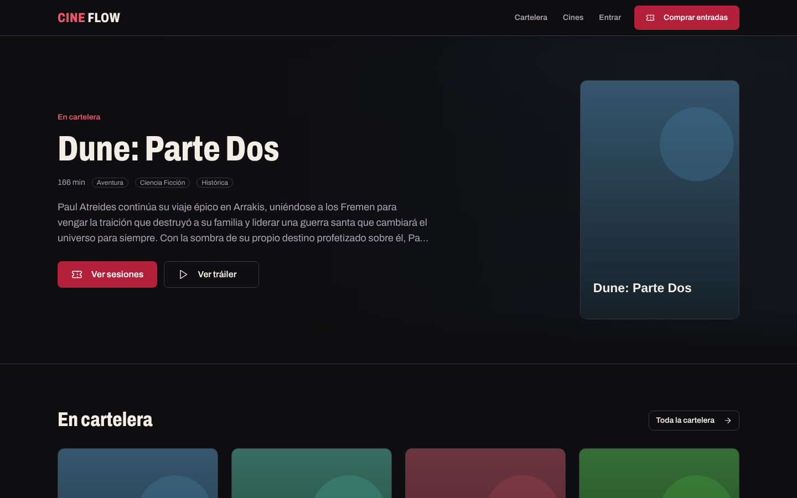
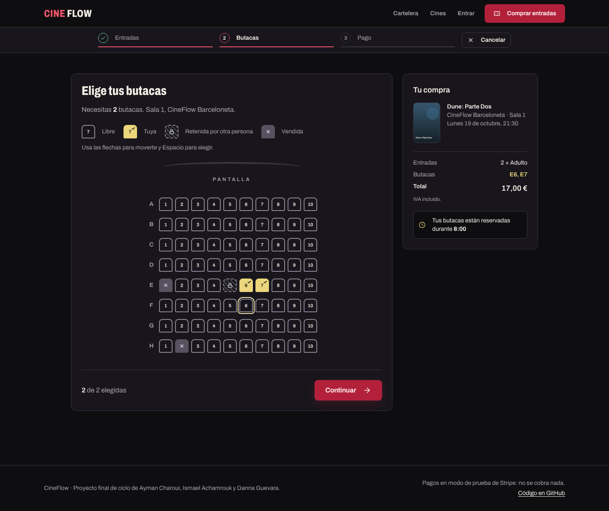
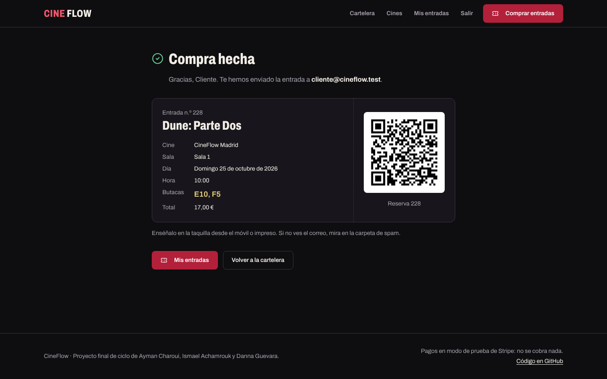

<h1 align="center">🎬 CineFlow Booking Engine</h1>

<p align="center">
  <strong>A complete cinema booking system with real-time seat locking (concurrency) and dynamic pricing logic.</strong>
</p>

<p align="center">
  
  
  
  
  
</p>

---

## What is this?

CineFlow is a production-grade cinema booking engine built with **Laravel 12**. It solves the hardest problem in any ticketing system: **stopping two people from buying the same seat at the same time**. It does this by combining real-time temporary seat locks with pessimistic database-level locking inside atomic transactions.

> Live demo: https://cineflow-ufe0.onrender.com/

## Key features

- 🔒 **Real-time seat locking (concurrency).** When a user selects a seat, a temporary `SeatLock` (8 minutes) is created, tied to their user/session. Other users see the seat as taken instantly via AJAX polling.
- ⚔️ **Double-booking prevention with pessimistic locking.** Purchase confirmation runs inside `DB::transaction(attempts: 3)` using `lockForUpdate()`, so two simultaneous purchases of the same seat get serialized and the second one fails cleanly instead of creating an overbooking.
- 💶 **Dynamic pricing.** The price is calculated from the session's `preu_base` by applying factors per ticket type: Adult ×1.00, Reduced ×0.80, Family ×0.82, Senior 65+ ×0.70.
- 💳 **Stripe Checkout payments (test mode), confirmed by a signed, idempotent webhook.** Seats stay held while paying and are released as soon as the payment expires or fails; if another purchase wins the seat, the payment is refunded. Without Stripe keys, a simulated payment (card or Bizum) keeps the app testable. See [Payments](#payments).
- 🎟️ **Tickets with signed QR codes (HMAC)** and a customer dashboard with booking history.
- 🗂️ **Zero-config to deploy.** Uses SQLite by default (no database server to provision); MySQL-compatible for dev/production.

## Tech stack

| Layer | Technology |
|------|-----------|
| Backend | PHP 8.4, Laravel 12, Eloquent |
| Payments | Stripe Checkout (`stripe/stripe-php`) |
| Frontend | Blade, Tailwind CSS, Vite, JavaScript (AJAX seat polling) |
| Database | SQLite (default) / MySQL |
| Infra | Multi-stage Docker, Render / Railway / Fly.io |
| Tests | PHPUnit (76 tests, including concurrency, race-condition and webhook tests) |

## Concurrency architecture

```
User A ──┐                          ┌── SeatLock (temporary, 8 min)
          ├─► /comprar/step2 ────────┤
User B ──┘   (seat selection)       └── AJAX polling /seat/status

Confirmation:
  DB::transaction(attempts: 3)
    └─► SELECT ... FOR UPDATE   (lockForUpdate)
          ├─ seat free  ──► creates Reserva + ReservaSeat, releases locks
          └─ seat taken ──► SeatAlreadyReservedException ──► back to step2
```

The result: **it's impossible to sell the same seat twice**, even under concurrent requests (covered by `ConcurrentPurchaseTest`).

## Quick start (Docker)

```bash
docker compose up --build
# App at http://localhost:8000
```

The container generates the app key, creates the SQLite database, and runs migrations and seeders automatically.

### Local install (without Docker)

```bash
composer install
npm ci && npm run build
cp .env.example .env
php artisan key:generate
touch database/database.sqlite
php artisan migrate --seed
php artisan serve
```

### Test users (seeder)

| Role | Email | Password |
|-----|-------|-----------|
| Admin | `admin@cineflow.test` | `admin1234` |
| Box office | `taquilla@cineflow.test` | `taquilla1234` |
| Customer | `cliente@cineflow.test` | `cliente1234` |

## Payments

Card payments use **Stripe Checkout in test mode**; the reservation is confirmed **only by a signed webhook**, never by the browser coming back.

1. **Pay.** Step 3 creates a `CheckoutPago` (status `abierto`) and a Checkout Session with one line per ticket type. Amounts are computed on the server, in integer cents, from the session price and the ticket-type factor (the same formula as the step 1 total). Every Stripe write carries an idempotency key (`checkout-pago-{id}`).
2. **Hold the seats while paying.** The 8-minute `SeatLock`s are extended to the Checkout Session expiry (30 min, Stripe's minimum) + 2 min, so nobody else can take them while the customer is on Stripe.
3. **Webhook `POST /stripe/webhook`.** The signature is verified before anything else (invalid or missing: `400`). Each `event_id` is stored in `stripe_eventos` inside the same transaction, so a repeated event is a no-op; the `CheckoutPago` row is locked and only acts while `abierto`, so two different events for the same payment create one reservation.
   - `checkout.session.completed` (paid) / `async_payment_succeeded` → `PurchaseService::confirmPurchase` (the same `lockForUpdate` transaction with 3 attempts), payment `pagado`, locks released, ticket emailed.
   - If another purchase won the seat a moment earlier → automatic **refund** (`reembolso-{id}`), payment `reembolsado`, logged in the `audit` channel.
   - `checkout.session.expired` / `async_payment_failed` → `caducado` / `fallido` and the seats are **released immediately**.
4. **Return page.** `/comprar/stripe/return` only shows "Confirmando tu pago…" and polls `/comprar/estado/{id}` (owner only, `403` otherwise) until the webhook has confirmed the reservation. Cancelling on Stripe expires the session and frees the seats.
5. **Safety net.** `php artisan checkout:limpiar` (scheduled every 5 minutes) expires abandoned payments if a webhook never arrives. Render has no cron, so there the `checkout.session.expired` webhook is the main path.

Stripe is enabled only when **both** `STRIPE_SECRET` and `STRIPE_WEBHOOK_SECRET` are set; otherwise step 3 uses the built-in simulated payment (card with Luhn check, or Bizum), which confirms directly.

```env
STRIPE_KEY=pk_test_xxx
STRIPE_SECRET=sk_test_xxx
STRIPE_WEBHOOK_SECRET=whsec_xxx
STRIPE_CURRENCY=eur
```

Try it locally with the [Stripe CLI](https://docs.stripe.com/stripe-cli):

```bash
stripe listen --forward-to localhost:8000/stripe/webhook   # prints the whsec_… secret for .env
php artisan serve
```

Pay with `4242 4242 4242 4242`, any future date and any CVC. In production, create the webhook endpoint in the Stripe dashboard pointing to `/stripe/webhook` with the events `checkout.session.completed`, `checkout.session.async_payment_succeeded`, `checkout.session.async_payment_failed` and `checkout.session.expired`.

## Screenshots

| Home | Seat map | Ticket |
|---|---|---|
|  |  |  |

## Accessibility

The interface targets **WCAG 2.2 AA** and is in Spanish.

- **Seat map as an accessible grid.** `role="grid"` with one toggle button per seat and a roving tabindex: arrow keys move, Home/End go to the ends of the row, Ctrl+Home/End to the first and last seat, Space or Enter selects or releases. Sold and held seats can be focused (so their state can be read) but not pressed.
- **States with shape, icon and text, not only colour.** Free (outline and number), yours (filled, ✓ and number), held by someone else (hatched, dashed border, padlock), sold (grey, ✕). Each seat's accessible name says it: "Fila F, butaca 7, retenida por otra persona".
- **Announced changes.** A polite live region says "Butaca F7 seleccionada. 1 de 2.", warns when someone else has just taken a seat, and the background polling updates the map without stealing focus or announcing every change.
- **Announced lock countdown.** The 8-minute hold is shown second by second, but screen readers only hear it at 5, 2 and 1 minutes and at 30 seconds; when it ends, the map reloads and focus moves to the message.
- **Forms**: visible labels, `aria-invalid` + `aria-describedby` on errors and focus on the first one; skip link, one `<h1>` per page, focus ring on everything, `prefers-reduced-motion` respected.

`tests/browser/a11y.spec.mjs` runs axe on 13 screens (home to ticket, including the three purchase steps) at 390 and 1440 px and fails on any serious or critical violation; `tests/browser/seat-map.spec.mjs` drives the seat map with the keyboard only. Both run in CI (`a11y` job).

## Tests

```bash
php artisan test
```

Runs 76 tests against SQLite: full purchase flow, lock expiration, race-condition prevention, pessimistic locking, guest locks, the Stripe webhook (signature, idempotency, refunds, seat release), views, authentication and profile.

## Deployment

The repo includes ready-to-use blueprints for several platforms:

- **Render** → `render.yaml`
- **Railway** → `railway.json`
- **Fly.io** → `fly.toml`
- **Docker** → `Dockerfile` + `docker/entrypoint.sh`

All of them use SQLite by default (zero database configuration). For production with MySQL, set the `DB_*` variables on the platform.

## Credits

CineFlow is the portfolio evolution of a final-cycle project (module M0616) originally developed as a team:

- **Ayman Charoui**
- **Ismael Achamrouk**
- **Danna Guevara**

This repo repackages, modernizes (real Stripe, deployment, CI) and documents that work. The original technical documentation is preserved in [`docs/`](docs/).

## License

[MIT](LICENSE).
</content>
